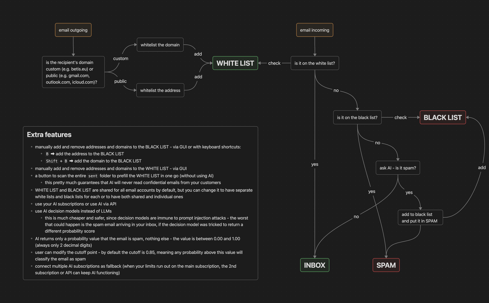

## Problem

I've been getting more and more spam, especially in the form of "cold emails", which basically means unwanted offers.
Companies are learning to use AI to help them send more spam like this.
This results in more and more spam coming in.
It will only keep getting worse.

I have the technical possibility to connect AI to scan my emails and get rid of spam for me, but I don't want to let AI into my email accounts. Not only that - formally I can't even do this in my company account, because I get confidential emails from customers.

## Solution

The following solution solves this problem completely without letting the AI read confidential emails, as long as you agree with the following statement:

*"If it's the 1st time a private person or a company is messaging me, I don't accept that it can be confidential."*

If yes, you are free to use AI.
If not, you may still benefit from this plugin without the AI, but it will only solve the problem partially.

This diagram is an obsidian canvas: [IDEA.canvas](IDEA.canvas)

## Extra features

- manually add and remove addresses and domains to the BLACK LIST - via GUI or with keyboard shortcuts:
	- `B` ⮕ add the address to the BLACK LIST
	- `Shift` + `B` ⮕ add the domain to the BLACK LIST
- manually add and remove addresses and domains to the WHITE LIST - via GUI
- a button to scan the entire `sent` folder to prefill the WHITE LIST in one go (without using AI)
	- this pretty much guarantees that AI will never read confidential emails from your customers
    - there is also an option to specify `start_date` and `end_date`, so that only a chosen portion of the `sent` folder is scanned
	- the correct `sent` folder is automatically chosen, but you can manually choose a different folder (e.g. if you have rules that split sent emails into different folders)
- WHITE LIST and BLACK LIST are shared for all email accounts by default, but you can change it to have separate white lists and black lists for each or to have both shared and individual ones
- use your AI subscriptions or use AI via API
- use AI decision models instead of LLMs
	- this is much cheaper and safer, since decision models are immune to prompt injection attacks - the worst that could happen is the spam email arriving in your inbox, if the decision model was tricked to return a different probability score
- AI returns only a probability value that the email is spam, nothing else - the value is between 0.00 and 1.00 (always only 2 decimal digits)
- user can modify the cutoff point - by default the cutoff is 0.85, meaning any probability above this value will classify the email as spam
- connect multiple AI subscriptions as fallback (when your limits run out on the main subscription, the 2nd subscription or API can keep AI functioning)

## Extra features for non AI usage

- create an extra folder on your email accounts and select it as the "screening folder" - this folder acts as something between `inbox` and `spam` - if sender is not on the white list and not on the black list, and no AI is used, put the email to this folder
    - this is so that `spam` always means "useless junk", and e.g. `screener` means "maybe junk, maybe not"

## Settings

- if no AI subscription is present, or it ran out, and the email is not on the white list and not on the black list, where to put the email?
    - default: to the `inbox`
    - `spam`
    - other folder
- cutoff point - probability score above which the email will be classified by spam by AI
