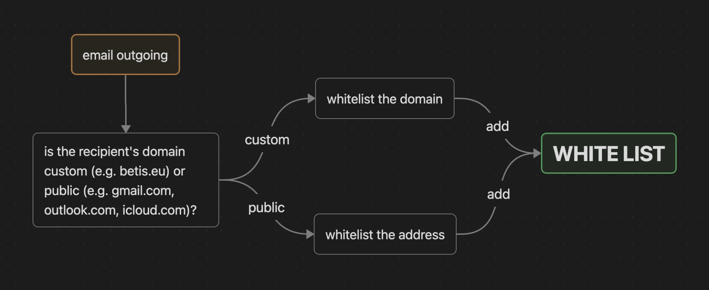

## Problem

I've been getting more and more spam, especially in the form of "cold emails", which basically means unwanted offers.
Companies are learning to use AI to help them send more spam like this.
This results in more and more spam coming in.
It will only keep getting worse.

I have the technical possibility to connect AI to scan my emails and get rid of spam for me, but I don't want to let AI into my email accounts. Not only that - formally I can't even do this in my company account, because I get confidential emails from customers.

## Solution

The following solution solves this problem completely without letting the AI read confidential emails, as long as you agree with the following statement:

*"If I've never written an email to this person or company, I don't accept that what they just sent me can be confidential."*

If yes, you are free to use AI.
If not, you may still benefit from this plugin without the AI, but it will only solve the problem partially.

Both diagrams are in one Obsidian canvas: [IDEA.canvas](IDEA.canvas)

## Extra features

- a button to scan the entire `sent` folder to prefill the WHITE LIST in one go (without using AI)
	- this pretty much guarantees that AI will never read confidential emails from your customers
    - there is also an option to specify `start_date` and `end_date`, so that only a chosen portion of the `sent` folder is scanned
	- the correct `sent` folder is automatically chosen, but you can manually choose a different folder (e.g. if you have rules that split sent emails into different folders)
- manually add addresses and domains to the BLACK LIST or remove them from it - via GUI or with keyboard shortcuts:
	- `Alt` + `B` ⮕ add the address to the BLACK LIST (sadly the shortcut can't be just `B` - it would require Thunderbird's Experiment APIs, which give the plugin full access to your computer, and I can't accept that)
	- `Alt` + `Shift` + `B` ⮕ add the domain to the BLACK LIST
- manually add addresses and domains to the WHITE LIST or remove them from it - via GUI
- WHITE LIST and BLACK LIST are shared by all email accounts by default, but you can change it to have separate white lists and black lists for each account, or to have both shared and individual ones
- use AI via API or your ChatGPT subscription (sadly connecting Claude, Grok, Muse, Gemini or Kimi subscriptions is not allowed, so I couldn't implement it)
- use AI decision models instead of LLMs
    - faster and cheaper
    - immune to prompt injection
- AI returns only a probability value that the email is spam, nothing else - the value is between 0.00 and 1.00 (always only 2 decimal digits)
- user can modify the cutoff point - by default the cutoff is 0.85, meaning any probability above this value will classify the email as spam
- connect multiple AI services as fallback (when your limits run out on the main subscription, the next connected service can keep AI functioning)

## Extra features for non AI usage

- create an extra folder on your email accounts and select it as the "screening folder" - this folder acts as something between `inbox` and `spam` - if the sender is not on the white list and not on the black list, and no AI is used, put the email into this folder
    - this is so that `spam` always means "useless junk", and e.g. `screener` means "maybe junk, maybe not"
    - shoutout to the team behind the **HEY** app - I took this cool idea from them

## Key settings

- if no AI service is present, or all of them failed (e.g. their limits ran out), and the sender is not on the white list and not on the black list, where to put the email?
    - default: leave it where it is (usually the `inbox`)
    - `spam`
    - the screening folder
- cutoff point - probability score above which the email will be classified as spam by AI
- prompt - you can modify the prompt that the AI receives regarding the email

## Privacy

- the plugin has no server of its own and collects no usage data - the WHITE LIST, BLACK LIST, settings and log stay in your Thunderbird profile - I made this plugin primarily for myself and I have no interest in your data - there is no business model here
- emails from senders on the WHITE LIST or the BLACK LIST never leave your computer (unless you send them to AI yourself as a test)
- only emails from unknown senders (on neither list) are sent, and only to the AI you connected yourself - it gets the sender, the `Reply-To` address, the recipients, the subject, the date and the first 20,000 characters of the text, never the attachments
- what the AI company does with them depends on its own terms
- without AI, or with an AI model running on your own computer (e.g. Ollama or LM Studio), no email leaves your computer
- API keys and sign-ins are stored unencrypted in your Thunderbird profile, and the plugin never asks for full access to Thunderbird or your computer

## MIT License

If you want to copy this idea and implement it in other email clients - please go ahead - the world would be better without cold emails.
